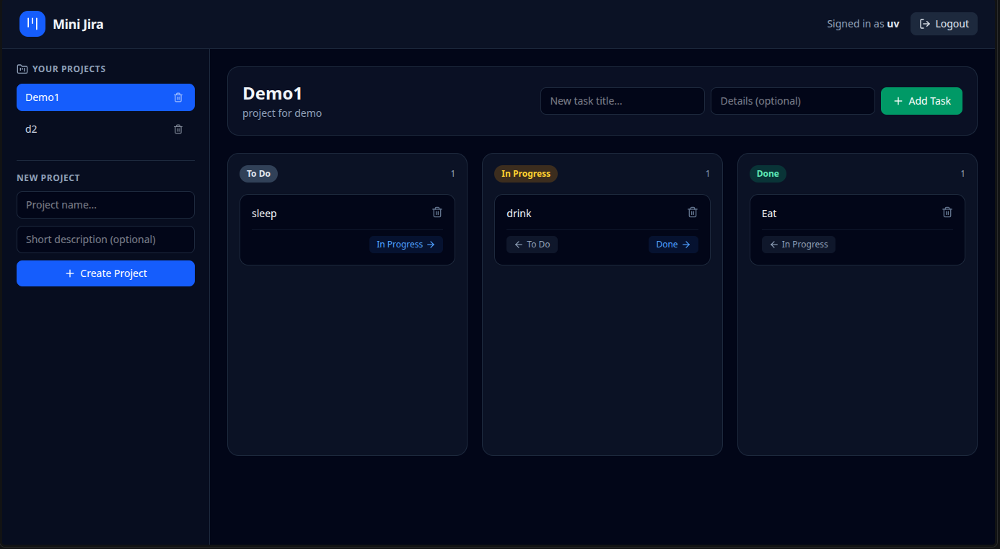
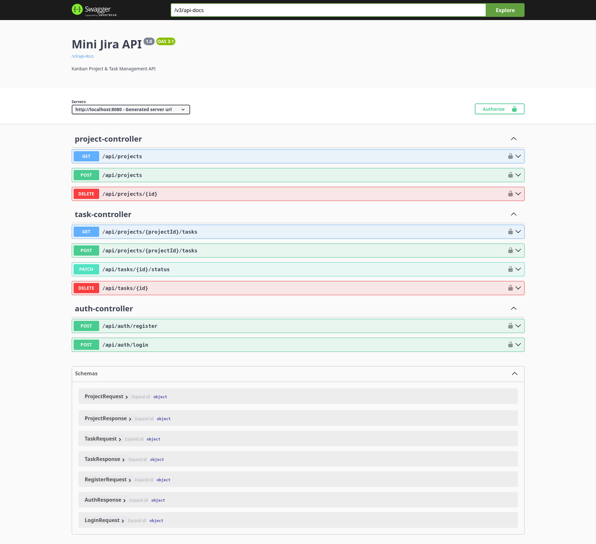

# Mini Jira

A full-stack project and task management web application with stateless JWT authentication, RESTful APIs, and an interactive 3-column Kanban board (`TODO` → `IN_PROGRESS` → `DONE`).



## Tech Stack

- **Frontend:** React 18, Vite, Tailwind CSS, Axios (with JWT Request Interceptor), Lucide Icons
- **Backend:** Java 21, Spring Boot, Spring Security, Spring Data JPA (Hibernate), Bean Validation, Lombok
- **Database:** PostgreSQL (`minijira`)
- **API Documentation:** OpenAPI 3.1 / Swagger UI (`springdoc-openapi`)

## Architecture & Data Model

```text
React + Tailwind UI (localhost:5173)
        │
        ▼  Axios Interceptor (Attaches Authorization: Bearer <JWT>)
Spring Boot REST API (localhost:8080)
        │
        ├──▶ JwtAuthFilter & SecurityConfig (Stateless Token Verification)
        ├──▶ REST Controllers & DTO Layer (/api/auth, /api/projects, /api/tasks)
        └──▶ Spring Data JPA / Hibernate
                │
                ▼
        PostgreSQL Database (minijira)
```

### Database Schema
- **`users`**: `id` (PK), `name`, `email` (unique), `password` (BCrypt hash)
- **`projects`**: `id` (PK), `name`, `description`, `owner_id` (FK → `users.id`), `created_at`
- **`tasks`**: `id` (PK), `title`, `description`, `status` (`TODO` | `IN_PROGRESS` | `DONE`), `project_id` (FK → `projects.id`), `created_at`

## Key Features

- **Stateless JWT Authentication:** User registration and login secured with BCrypt password hashing and 24-hour signed JWTs validated via a custom `JwtAuthFilter`.
- **User-Scoped Workspaces:** Authenticated users can create, view, and delete only their own projects via `SecurityContextHolder` ownership checks.
- **3-Column Kanban Workflow:** Create tasks inside projects and transition card statuses across `TODO`, `IN_PROGRESS`, and `DONE` via a `PATCH` endpoint with instant UI updates.
- **DTO Decoupling:** Separate Request/Response DTOs isolate database entities from API contracts and prevent password or entity leakage.
- **Interactive Swagger UI:** Auto-generated OpenAPI 3.1 documentation with Bearer JWT authorization support at `/swagger-ui.html`.

## API Endpoints

### Authentication (`/api/auth`)
| Method | Endpoint | Description | Access |
| :--- | :--- | :--- | :--- |
| `POST` | `/api/auth/register` | Register a new user and return a signed JWT | Public |
| `POST` | `/api/auth/login` | Authenticate credentials and return a signed JWT | Public |

### Projects (`/api/projects`)
| Method | Endpoint | Description | Access |
| :--- | :--- | :--- | :--- |
| `POST` | `/api/projects` | Create a new project owned by the logged-in user | JWT |
| `GET` | `/api/projects` | Fetch all projects belonging to the logged-in user | JWT |
| `DELETE` | `/api/projects/{id}` | Delete a project (owner-verified) | JWT |

### Tasks (`/api`)
| Method | Endpoint | Description | Access |
| :--- | :--- | :--- | :--- |
| `POST` | `/api/projects/{projectId}/tasks` | Create a task in a project (defaults to `TODO`) | JWT |
| `GET` | `/api/projects/{projectId}/tasks` | Retrieve all tasks for a project's Kanban board | JWT |
| `PATCH` | `/api/tasks/{id}/status?status=` | Update task status (`TODO`, `IN_PROGRESS`, `DONE`) | JWT |
| `DELETE` | `/api/tasks/{id}` | Delete a task | JWT |

## Screenshots

| Sign In | Create Account |
| :---: | :---: |
|  |  |

### Interactive API Documentation (Swagger UI)


## Local Setup

### Prerequisites
- Java 21 & Maven
- PostgreSQL (running on `localhost:5432`)
- Node.js (v18+) & npm

### 1. Database
Create an empty PostgreSQL database named `minijira`:
```sql
CREATE DATABASE minijira;
```

### 2. Backend
```bash
cd backend
```
Set your database password and JWT secret via environment variables (or a git-ignored `application-local.properties`):
```bash
export DB_PASSWORD=your_postgres_password
export JWT_SECRET=your_256_bit_base64_secret
./mvnw spring-boot:run
```
- **API Base URL:** `http://localhost:8080`
- **Swagger UI:** `http://localhost:8080/swagger-ui.html`

### 3. Frontend
```bash
cd frontend
npm install
npm run dev
```
- **Frontend App:** `http://localhost:5173`